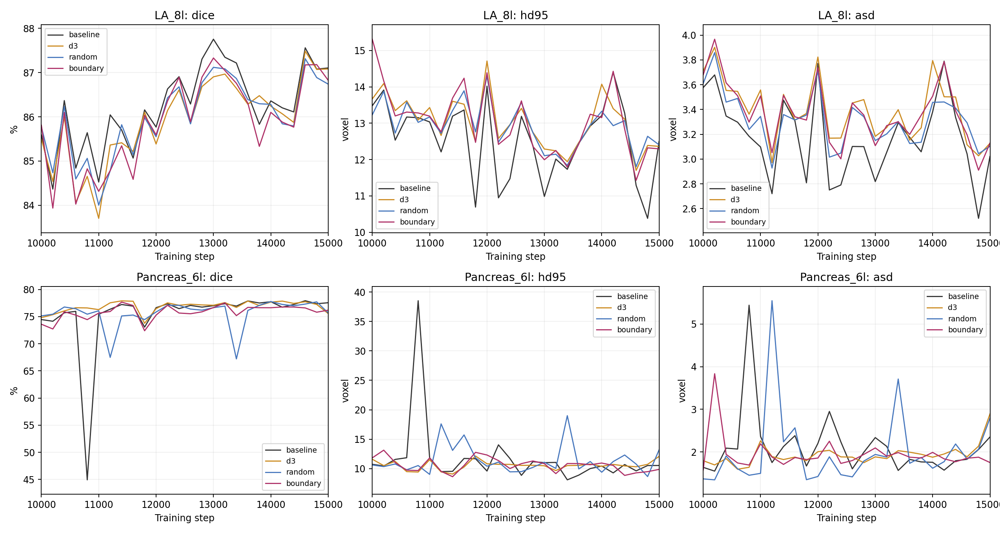
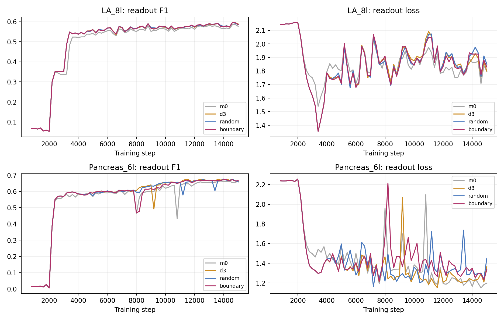
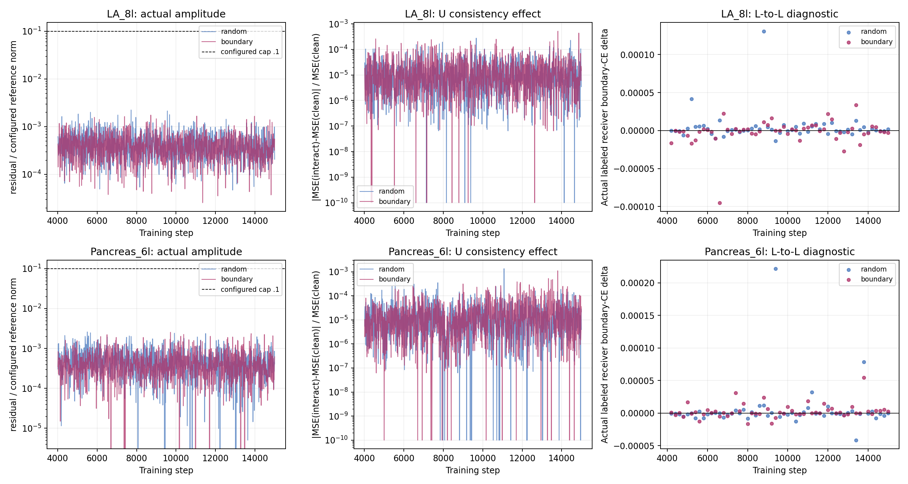
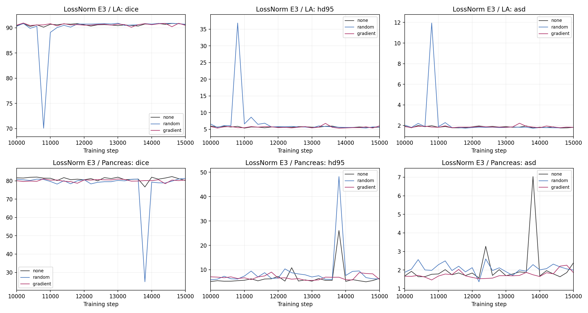

# M0 与 D3 L→U 实验结果复核（2026-10-30）

本报告分析完整训练期间已保存的记录，包括六组正式实验、原 MT_DS、D3 无交互对照及先前边界条件；另将 IDE 中的 LossNorm D2/E3 六组作为独立路线比较。分析未加载权重、追加推理或启动新训练。

可复现入口：[analyze.py](../analysis/d3_stage2_review_2026-10-30/analyze.py)。机器可读结果：[analysis.json](../analysis/d3_stage2_review_2026-10-30/analysis.json)；各指标、逐病例差值、训练阶段与注入记录均导出为同目录 CSV。

## 主要判断

1. **M0 成功隔离了边界读出与主干优化。** 两数据集全部 72 次验证的 Dice、JC、HD95、ASD 均与 Baseline 完全一致，最佳及最终指标也一致。M0 仍能学到边界读出并产生局部有效评分，说明“必须先用边界损失更新主干，才能归因”不成立。
2. **D3 联合监督有辅助任务收益，但没有形成整体分割收益。** 训练边界损失下降更多、平均读出 F1 和部分主输出归因对应有所改善；LA 分割退化，胰腺 Dice 基本持平且存在距离指标取舍。不能把辅助头拟合好直接解释为主干学到了可迁移的边界知识。
3. **当前 L→U 实现未证明有效，也没有证明边界选择优于随机。** 同时必须承认其检验力度不足：实际残差极小，投影参数梯度与一致性变化也极小。这个阴性结果不能直接否定所有边界贡献交互。
4. **供体移除贡献与接收方注入收益是不同问题。** 原遮挡校准仍成立，但实际跨病例注入没有呈现可靠的接收方改善。
5. **独立 LossNorm E3 路线也未建立梯度选择优势。** LA 的最佳点有极小改善，最终点反而下降；胰腺最终点有改善，但梯度组不及随机，且随机出现过严重瞬时预测失败。

## 完成性与可比性

本轮 `M0_D3_readout_v1`、`D3_L2U_random_v1`、`D3_L2U_boundary_v1` 各覆盖 LA 10%/Pancreas 10%，均 completed、15000 步、1501 个训练日志点、72 次完整主验证、最佳模型复测完成。主验证全部 20 例均有有效表面指标，没有用部分病例均值替代本轮主结果。各组保存的源码快照哈希、病例划分、主目标、原网络和评价实现通过核对。两交互组前 4000 步与旧 D3 无交互对照的监督损失差异至多约 `6e-8`，其他主要损失/梯度记录相同。

主要配置仍为 seed42、SGD/LR0.01、batch2L+2U、原四尺度分割/一致性、Teacher 原 BN/EMA、D3 边界系数前2000步关闭再2000步升至0.015。交互在4000步后启用，未加入Bank、反向U→L或无标签边界训练项。

**胰腺随机组有明确的恢复混杂。** 该组在4000步后因显存不足退出，从自身4000步断点按原配置恢复。模型、优化器和RNG恢复并不等于采样器/预取状态恢复。现在已能从实际记录确认：恢复前401个抽样日志点的L/U病例顺序与M0完全一致；恢复后1100个抽样点没有一个完整L/U配对与M0一致，边界目标质量记录也发生变化。胰腺边界组、LA两交互组则全程保持病例顺序和目标质量对应。

因此，胰腺 random 与 boundary 的差值包含恢复后采样顺序差异，不能全部归给选择规则；也不能反过来断言恢复必然造成性能下降。LA 中不存在这一混杂，但也没有看到边界选择的可靠收益。

## Dice-best 模型的主指标

以下 HD95/ASD 均来自**该行 Dice-best 的同一个模型**，不是分别挑选距离指标的最佳点。Dice/JC 为百分比；距离为 voxel，ASD 为原单向定义。

| LA 10% | 最佳步数 | Dice ↑ | JC ↑ | HD95 ↓ | ASD ↓ |
| --- | --- | --- | --- | --- | --- |
| Baseline | 13000 | 87.7548 | 78.4670 | 10.9855 | 2.8182 |
| M0，仅训练边界读出器 | 13000 | 87.7548 | 78.4670 | 10.9855 | 2.8182 |
| D3 联合监督，无交互 | 14600 | 87.4866 | 78.2181 | 11.7011 | 3.1151 |
| D3＋随机 L→U | 14600 | 87.3140 | 78.0266 | 11.8012 | 3.2931 |
| D3＋边界贡献 L→U | 13000 | 87.3300 | 77.9348 | 11.9954 | 3.1081 |

LA 边界选择相对随机的 Dice 差异只有 **+0.0160 个百分点**，HD95 更差、ASD 更好，没有统一优势；两组 Dice 都低于无交互 D3，也低于 Baseline。不能以这0.016个百分点支持评分有效。

| Pancreas 10% | 最佳步数 | Dice ↑ | JC ↑ | HD95 ↓ | ASD ↓ |
| --- | --- | --- | --- | --- | --- |
| Baseline | 14600 | 77.9374 | 64.7436 | 9.6142 | 1.8288 |
| M0，仅训练边界读出器 | 14600 | 77.9374 | 64.7436 | 9.6142 | 1.8288 |
| D3 联合监督，无交互 | 11400 | 77.9102 | 64.6660 | 9.0755 | 1.8233 |
| D3＋随机 L→U（有恢复） | 14000 | 77.7859 | 64.5979 | 9.3865 | 1.6203 |
| D3＋边界贡献 L→U | 11400 | 77.6809 | 64.6083 | 8.6250 | 1.7097 |

胰腺边界组相对无交互 D3 的 Dice 为 **−0.2293 个百分点**，HD95改善0.4504、ASD改善0.1137；相对Baseline的Dice为−0.2565个百分点。这是区域重叠与距离指标的取舍，不能说所有指标都变差，也不能称整体胜出。随机组的ASD最好，同样不支持距离收益来自边界评分本身。

### 最终点与末期曲线

“末期”统一指12200–15000步，共15次验证；相邻时间点不是独立重复。

| 条件 | LA最终Dice | LA末期均值 | 胰腺最终Dice | 胰腺末期均值 |
| --- | --- | --- | --- | --- |
| Baseline/M0 | 87.1046 | 86.8141 | 77.5646 | 77.2697 |
| D3无交互 | 87.0826 | 86.5593 | 75.5704 | 77.2624 |
| 随机L→U | 86.7392 | 86.5555 | 75.7009 | 76.2403 |
| 边界贡献L→U | 86.8264 | 86.5160 | 76.1923 | 76.3855 |

胰腺边界组在最终15000步比D3好0.6219个百分点，但末期平均低0.8769个百分点。这说明不能仅引用最后一步的回升认定交互改善稳定性。其末期HD95/ASD均值10.3226/1.9026，比D3的10.6134/2.0048略好，仍是与Dice下降并存的取舍。

### 逐病例差异

LA边界组相对Baseline，20例中有13例Dice提高、7例下降，但均值仍下降。两个明显损失病例 `WSJB9P4JCXUVHBOYFVWL` 和 `YDKD1HVHSME6NVMA8I39` 分别下降6.4030、4.9710个百分点；前者HD95增加23.2929 voxel。故“多数病例略有改善、少数困难病例明显变差”比“所有病例都恶化”更符合记录。随机组这两个病例下降11.2885、7.7955个百分点，问题更突出。

胰腺边界组有12/20例Dice提高、14例HD95改善、4例HD95变差、2例持平；但 `image0009` 的Dice下降8.1465个百分点，`image0051` 下降4.0515个百分点，抵消了其他病例收益。需要关注困难病例与异常误分，不能只追求平均边界读出损失下降。

详细逐病例数据：[case_deltas.csv](../analysis/d3_stage2_review_2026-10-30/case_deltas.csv)。这些是各组按历史Dice-best选出的模型比较，不构成独立测试证据。

### 与先前边界条件的关系

| 先前条件 | LA Dice-best | 胰腺 Dice-best | 本轮复核支持的解释 |
| --- | --- | --- | --- |
| 0.03窄带CE | 87.1013 | 76.2354 | 未形成整体收益，胰腺距离有取舍 |
| half＋full独立边界头0.03 | 87.1979 | 77.5752 | 未形成整体收益 |
| E4旧辅助分支0.03 | 87.1843 | 79.0164 | 胰腺Dice提高，LA退化，不能作为跨器官规律 |

E4在胰腺比Baseline高1.0790个百分点，但其ASD为2.1863，差于Baseline的1.8288；LA的HD95/ASD也明显更差。保留它作为器官依赖的辅助任务收益证据是合理的，却不能因此认定应该全面返回E4。E4/D3之间目标、头、时间表及权重均不同，不能当作纯位置消融。本轮结果同样不支持继续仅靠换边界损失或加大监督强度推进。

## M0 回答了什么

M0与Baseline在两数据集的72次验证中，四项主指标每次均完全一致。训练记录的区域/CE差异至多约6e-8，一致性损失一致。这与原先detach、BN/RNG隔离的实现检查相符，说明读出器没有意外改变主分割训练。

M0的边界头仍然学会读出：末期中心patch边界带F1均值为LA **0.5756**、胰腺 **0.6578**。D3联合监督对应为0.5840/0.6695，有小幅辅助读出改善；其末期训练边界loss也由M0的0.4088/0.4850降到D3的0.3453/0.3559。但这些改善没有转化为两数据集的整体主分割优势。

这里的F1是固定中心patch、阈值0.5的边界带F1，不是整器官Surface Dice，也不是同一评价任务下的主Dice。

| 成熟期4000–15000的诊断 | M0 LA | D3 LA | M0胰腺 | D3胰腺 |
| --- | --- | --- | --- | --- |
| 小幅干预一阶预测与实测的组内Pearson均值 | 0.9909 | 0.9949 | 0.9928 | 0.9956 |
| 辅助边界loss变化与最终输出边界CE变化的组内Spearman均值 | 0.4286 | 0.5714 | 0.1679 | 0.3304 |
| 高分组弱化对最终边界CE的损害大于随机均值 | 43/56 | 49/56 | 42/56 | 46/56 |

解释应分三层：局部一阶评分基本能预测同算子的局部弱化；它与最终分割有部分对应，尤其胰腺仍偏弱；它尚未证明跨病例传递价值。M0也有很高的局部Pearson，进一步说明这种校准不是“边界监督已改善主干”的充分证据。

M0提供了一条可行备选：让边界头成为评价工具，先不强制边界梯度更新主干。但本轮没有M0＋交互条件，不能宣称这种组合一定更好，也不能由一个seed否定所有联合监督。

## 当前交互最主要的实现问题：实际信号过弱

下表统计5001–15000步的1000个日志采样点、每点2个接收样本。相对范数分母为本轮配置的 `||F_U*mask||*sqrt(4/32)`，**不是整个skip特征的范数**。

| 数据集/规则 | 实际相对残差均值 | 95%分位 | 有活跃残差的样本比例 | 投影参数梯度范数均值 |
| --- | --- | --- | --- | --- |
| LA随机 | 0.0448% | 0.1291% | 100% | 1.24e-7 |
| LA边界 | 0.0413% | 0.1124% | 100% | 1.52e-7 |
| 胰腺随机 | 0.0519% | 0.1543% | 89.9% | 8.76e-8 |
| 胰腺边界 | 0.0458% | 0.1419% | 88.0% | 1.01e-7 |

α=0.1只提供**10%的上限**。本轮实际均值约0.04%～0.05%，比这个上限小约200倍以上。四组交互中，`|MSE_interacted−MSE_clean|/MSE_clean` 的成熟期均值也只有约0.0016%～0.0029%。接收方确有变化，但非零并不意味着已形成足够强的学习信号。

上一轮短跑检查验证了“梯度存在、没有状态污染、实际发生注入”，却没有把“实际注入与学习信号是否达到预期量级”纳入启动门槛。这是本轮实现和验证中需要明确修正的一点，不能简单把结果不好归给研究方向。

### 为什么配置0.1仍会这么小

当前代码的核心是：

`scale=min(1, alpha*reference_norm/raw_norm)`，`residual=raw*scale`。

它只压低过大的raw，不放大已经很小的raw。成熟期已记录的单样本最大相对幅度也低于0.006，远低于0.1上限，因此继续把α上限调大并不能自动修复这个问题。

此外，内外两个原型的value被中心化。因value线性层无bias，可写成 `v_in=d, v_out=-d`，聚合就是 `(a_in-a_out)*d`。如果两个attention接近，输出会进一步抵消，再经过投影、通道mask和空间置信度mask。**这提供了信号缩小的结构性解释，但没有保存attention/原型对比范数，不能声称已逐项证实究竟哪一级是主因。**

投影模块只受U一致性训练，并没有在L接收方边界任务上训练。它可以趋向维持Teacher预测，而不必使用供体知识；在极小信号下，不能把“可训练投影”自动当成“学会了传递”。这也是待验证机制，不是本轮已经确认的单一退化原因。

## 真实注入与供体评分之间仍缺什么

本轮每200步记录batch内另一个L病例向L接收方注入的真实变化，接收方GT只用于评价。边界选择组共有55次诊断：

- LA最终边界CE平均变化−1.64e-6；按绝对变化1e-6为描述阈值，23次下降、22次上升、10次很小。
- 胰腺最终边界CE平均变化+3.04e-6；16次下降、24次上升、15次很小。
- LA所有55次patch Dice变化绝对值均小于1e-5；胰腺47/55次小于这个阈值。阈值只是量级描述，不是统计显著性界限。

没有看到跨病例注入稳定改善接收方边界的证据。不能仅按55个正负号计数判断有效，很多变化太小，且这些记录不是独立种子重复。

供体分数 `S_d=-∂L_b^d/∂g_d` 评价的是“减弱供体通道会怎样”。实际交互需要回答：

`ΔL_receiver ≈ <∇_F_receiver L_receiver, ΔF_donor→receiver>`。

这是不同样本、不同方向、不同操作。供体里重要的通道，不保证其原型残差在当前接收方上朝着降低边界误差的方向。下一轮需要校准**真实注入方向**，而不只是再证明删除高分通道会让供体变差。

## IDE 中的独立 LossNorm D2/E3 路线

该路线在 `MT_DS_LossNorm_Channel/analysis/channel_interaction/D2_E3_LU_interaction`。它保留聚合标量stop-gradient LossNorm，使用键控采样/增强、严格FP32和另一套确定性CE归约；在Student-U的E3编码特征处，对16/64通道做 `F_U+0.1*(F_L.detach−F_U)`，没有边界目标或新增头。评分为L/U卷积参数梯度的余弦乘范数平衡项。

**它的none才是匹配对照。** 不能用它的90.86%/82.31%直接对比本项目87.75%/77.94%，进而把差异归给通道交互或某一个单独设置。

六组均已有15000次实际SGD/EMA、72次验证和独立完成核验。原入口末尾构造completed状态时发生重复参数错误，保留了原exit1/failed；`FINAL_STATUS.json` 和每组 `COMPLETION_VERIFICATION.json` 已确认错误限于末尾状态构造。无需因旧failed标签重训。

该方案预先指定15000步为主要比较，另报Dice-best及末十次验证：

| 数据集/条件 | Dice-best | 最佳步数 | 最终15000步Dice | 末10次Dice均值 |
| --- | --- | --- | --- | --- |
| LA none | 90.8646 | 14600 | 90.6589 | 90.6687 |
| LA random | 90.9010 | 13000 | 90.6975 | 90.7317 |
| LA gradient | 90.9463 | 10200 | 90.4895 | 90.6052 |
| Pancreas none | 82.3051 | 14600 | 80.1763 | 80.7054 |
| Pancreas random | 81.3348 | 15000 | 81.3348 | 74.5733 |
| Pancreas gradient | 81.1019 | 10800 | 80.4741 | 80.0724 |

LA梯度组最佳点比none高0.0816个百分点，但最终比none低0.1693个百分点，也比random低0.2079个百分点，末期均值没有优势。仅凭最佳点不能支持梯度选择。

胰腺按预先指定的最终点，random比none高1.1585个百分点，gradient高0.2977个百分点；不能说交互从无收益。但gradient比random低0.8608个百分点，Dice-best又比none低1.2033个百分点，仍没有建立梯度选择的额外价值。gradient的ASD有改善：Dice-best时1.4648，相比none的1.6375；最终ASD1.8527，相比none的2.3915。HD95/重叠/稳定性需共同看。

**random的胰腺末期均值被一次严重失败拖低：** 13800步Dice仅24.8758%，有7/20例Dice为0、表面距离缺失；14000步恢复79.2706%，15000步达到81.3348%。该时点HD95/ASD只平均13例，不能按20例完整评价解释。none同期也有波动（13800步76.6404%），gradient同期80.1409%；现有记录不足以把失败精确归因于BN或某一次混合。none/gradient早期1400、1600步也有19例有效表面距离，最佳/最终都为20例。

这条路线确实产生了交互：两种规则在13000个联合训练步骤均选择16通道，E3整体相对变化均值约5.98%～6.00%；MSE相对参考前向的绝对变化均值约3.72%～4.94%。其分母与D3残差日志不同，不将两者直接作数值强度倍数比较。梯度规则选中的平均分数确实高于随机，但这没有转化为可靠的性能优势。

三条件全部15000步的batch/增强哈希一致，D2没有上述D3胰腺恢复后的批次混杂。

## 下一步的建议

当前不宜据此加Bank、双向交互或更多尺度，也不宜立即开始新一轮边界损失权重搜索。优先级应是：

1. **先修正交互算子及启动门槛。** 控制并记录实际相对范数，而不只配置一个很少触及的上限；同时记录原型对比范数、attention差异、投影前后幅度、接收方logit/目标变化和投影学习量。避免只凭非零通过便投入完整训练。
2. **优先检验实际注入方向。** 利用训练中的L→L受控诊断，检验供体选择是否预测接收方真实改善；加入空供体/打乱供体的在线诊断，判断接收方是否真的使用供体内容。对U只使用Teacher信息，不能用隐藏真值校准。
3. **将M0作为干净读出候选，保留联合监督为可检验选择。** M0已证明能提供信号且维持Baseline行为；M1在辅助任务上有改善，但还不足以要求其成为所有交互实验的必选组件。未来条件要明确固定使用哪一支，不能同时改边界目标、位置、权重和交互机制。
4. **有效强度与接收方作用确认后，再配套从头训练。** 同一协议下LA10%/Pancreas10%均比较无交互、随机、贡献选择；匹配实际幅度预算与训练状态。新条件不得用旧权重静态分析替代训练。恢复需保证数据顺序可复现；若改键控采样/数值协议，则对应Baseline也需匹配。

当前最有把握保留的是“边界读出可以形成局部评价信号”。“边界联合优化必需”和“供体高分自动带来跨病例传递收益”均未被建立。本轮的下一问题应收紧为：**在有可测作用的同幅度注入下，边界贡献选择能否比随机更有利于接收方及最终分割？**

以上都是单seed42、历史test在线选模协议下的开发结论。相邻验证点和诊断点不可当成独立种子，距离单位仍为voxel；本轮没有ASSD或Surface Dice，不能把边界带F1替代这些指标。
